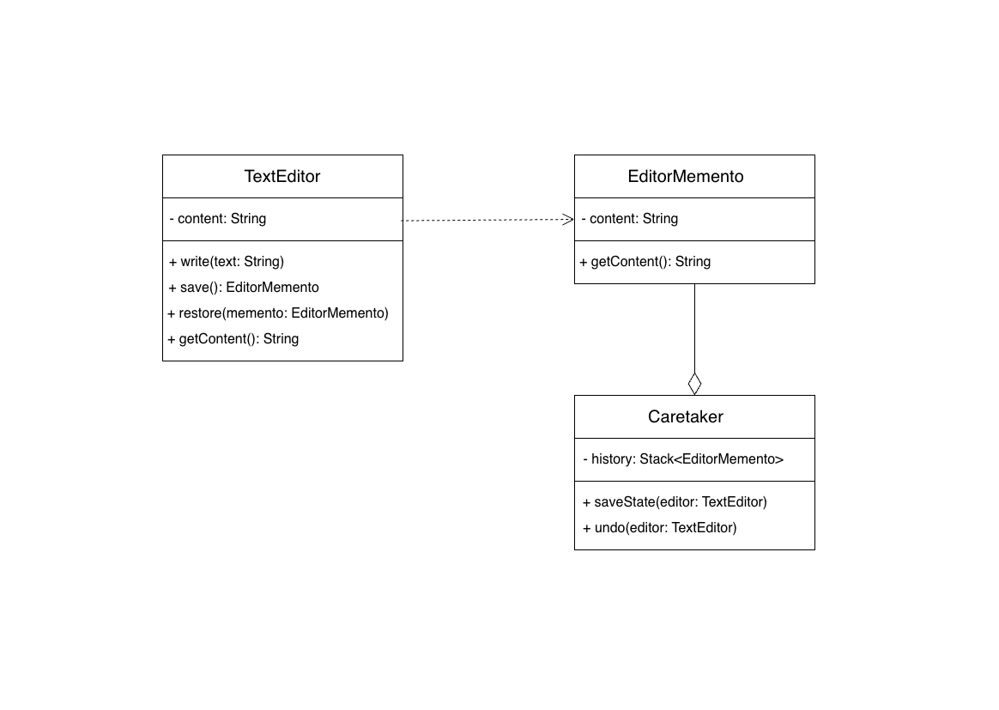

# Memento Design Pattern

The **Memento Design Pattern** lets you capture and save an object’s internal state so it can be restored later, without exposing its internal structure. This is especially useful for implementing undo or rollback features.

---

## Structure Explanation Using the Example Image

---

### Key Participants (as depicted in the image):

- **TextEditor (Originator):**
    - Maintains the main state (`content`).
    - Provides methods to modify content, create a memento (snapshot), and restore from a memento.
    - Responsible for creating and restoring its own mementos.

- **EditorMemento (Memento):**
    - Stores a representation (snapshot) of the TextEditor's state at a point in time.
    - Exposes only minimal access (e.g., content retrieval) to prevent outside modification.
    - Used internally by the Originator, while other objects shouldn’t change its state.

- **Caretaker:**
    - Manages a history stack of EditorMementos.
    - Calls TextEditor’s save/restore methods but does not directly access or modify the EditorMemento’s internal state.
    - Enables undo functionality by retrieving the previous memento and passing it to the TextEditor for restoration.

---

### Workflow Illustrated by the Image

1. **Writing/Changing State:**  
   The TextEditor updates its content through the write method.

2. **Saving the State:**  
   Caretaker requests the TextEditor to save its current state. The TextEditor creates an EditorMemento and returns it to the Caretaker, which stores it in history.

3. **Undo/Restore:**  
   When undo is needed, the Caretaker fetches the last EditorMemento and instructs the TextEditor to restore its content to that saved state.

---

### Principles Highlighted

- **Encapsulation:**  
  The internal state of TextEditor is kept private; only EditorMemento can carry its snapshot, and only TextEditor restores from it.

- **Separation of Concerns:**  
  The image shows that the Caretaker manages mementos (history), while the TextEditor handles state logic, and EditorMemento acts as a simple container.

- **Undo Functionality:**  
  Storing multiple EditorMementos allows the application to rollback states as needed—ideal for text editors and similar use cases.

---

## When to Use

- Implementing undo/redo in editors and games.
- Rolling back states in transactional systems.
- Saving checkpoints or history in user-centric apps.

---

**Conclusion:**  
This UML diagram exemplifies how the Memento Pattern enables state preservation and restoration without violating encapsulation. The pattern is powerful for any scenario needing rollback, history, or undo/redo functionality.
